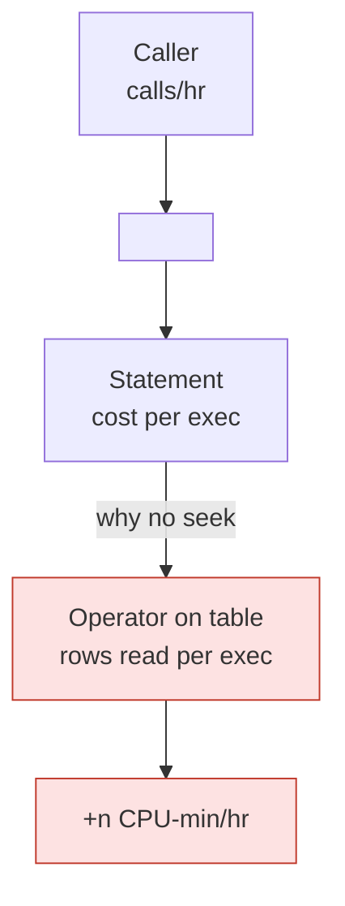
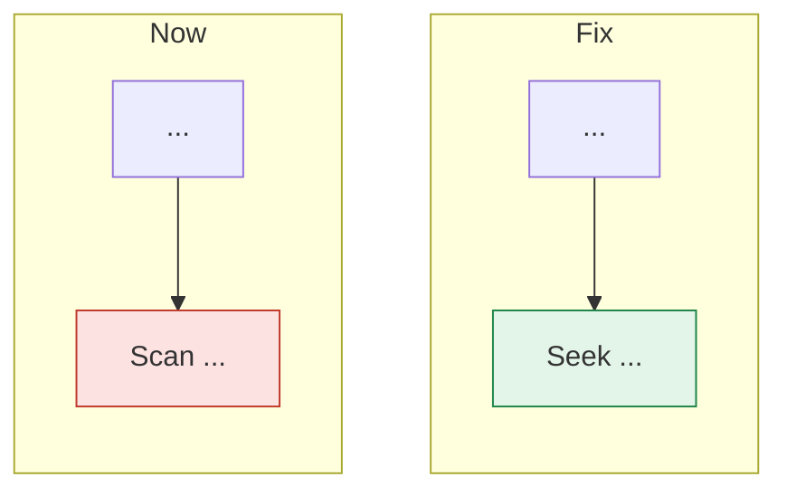

# <Object or area>: <what's wrong, in a phrase> (<server role> / <database>, <date>)

## Verdict

<3–5 lines. What is expensive or failing, how much it costs (CPU-min/day, latency, errors), the root cause in one sentence, the fix, the expected saving, and the status (proposed / ready to deploy / deployed and verified).>

| | Before | After (measured or expected) |
|---|---:|---:|
| Per call / per run | | |
| Per hour (business hours) | | |
| Per day | | |

## Scope and method

- **Server / database:** <role, version, compatibility level, CE>.
- **Windows (<time zone>):** <before>, <after>, <week-ago reference>; <mixed hour excluded>.
- **Sources:** Query Store (<interval> min), plan-cache DMVs, cached and Query Store plan XML, catalog views. Read-only; no writes, no temp tables.
- **Scripts:** `<repo>\sql\<topic>\01–nn_*.sql`, each with its result file.

## Finding 1: <statement / operator in a phrase>

**Evidence**

| Measure | Value |
|---|---:|
| Share of object CPU | |
| CPU / reads / rows per execution | |
| Executions per hour / day | |
| Plans (flips) | |

**Root cause.** <Statement N spends X because operator O reads R rows of table T per execution, since predicate P can't seek index I.>



**Fix.**



```sql
-- the changed lines, marked
```

**Proof.** <patched / original / patched table: CPU, elapsed, reads, rows identical.>

**Reproduce it.** `repro_<object>.sql` (read-only) runs the statement as shipped and with the change and prints CPU, reads, physical I/O and waits per run, plus the environment and data shape it depends on. Anyone can re-run it after an upgrade; the vendor gets the same file.

**Saving.** ≈ <n> CPU-min/day; <other effects: fewer parallel queries, timeouts gone>.

## Finding 2: …

## Variants tried and rejected

| Variant | CPU | Rows | Why rejected |
|---|---:|---|---|

## Ruled out

- <blocking, I/O latency, load growth (business volume flat), a missing index that wouldn't help, …>

## Next steps

| Step | Owner | Script / doc |
|---|---|---|
| Parity check, then guarded deploy | DBA | `sql\vendor_patches\<object>\` |
| Send the vendor note with its reproduction kit | <name> | `<Vendor>_<object>.md`, `repro_<object>.sql`, the two `.sqlplan` files |
| Re-check after the next upgrade | DBA | `Verify_<object>.sql`, section 1 |

## Updates

### <date time>: <deployed / hot-fix verified / correction>
<What changed, with the new numbers. If correcting an earlier figure, say "Correction:" and give both.>
