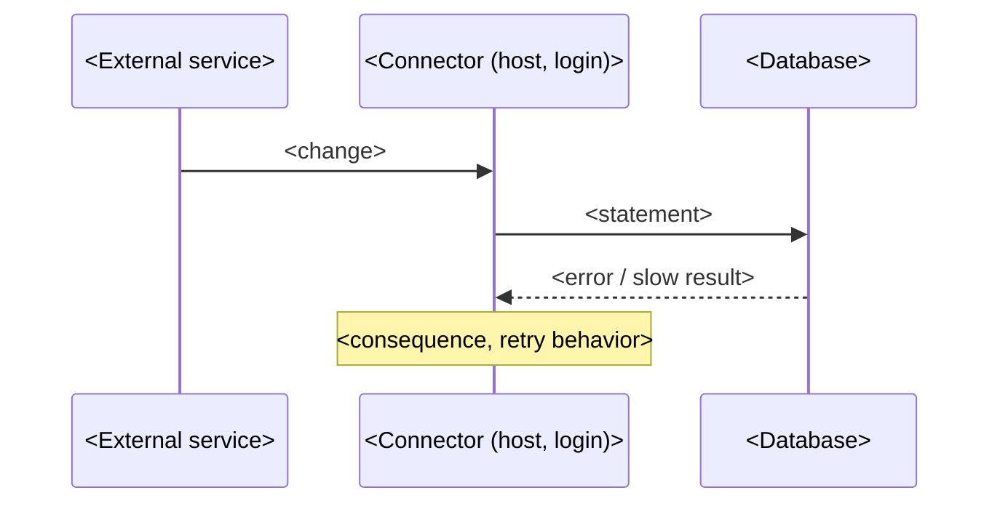

# <Product / component>: <defect in one line>

**For:** <vendor> support (<module>)
**From:** <company>, DBA team (<date>)
**Severity requested:** <P2 – data not saved for n records / performance>
**Environment:** <product version>; SQL Server <version> (<build>), compatibility level <n>, <legacy | default> CE; <database>

## 1. Summary

<3–4 sentences: what fails or costs, since when, how often, what it breaks for the business, and what we need from the vendor.>

## 2. Which component this is, and how we know

| Evidence | Value |
|---|---|
| Login | `<login>` (created <date time>) |
| Host / process | `<host>`, PID <n> (Windows service <name, if confirmed by the user>) |
| Client library | `<client_interface_name>`; Application Name <blank / value> |
| Installed | <settings rows / data loaded on <date>, matching the login's creation> |

## 3. The defect

The statement as SQL Server receives it (from the plan cache / Query Store):

```sql
<exact text with parameter declarations>
```

<Why it fails or is slow, in the vendor's terms: e.g. "COALESCE returns the highest-precedence type of its arguments, so COALESCE(@p bigint, col varchar(12)) is bigint; any existing non-numeric value raises 8114 even when @p is NULL.">



## 4. Evidence: volumes and trend

| Day | Failed | Succeeded | Notes |
|---|---:|---:|---|

## 5. Impact assessment

| Area | Impact |
|---|---|
| Data | <n records never updated; which fields; how stale> |
| Business | <who sees wrong data; compliance / billing / dispatch consequence> |
| Exposure | <n records that would hit the same bug on their next change> |
| Performance | <CPU, log, retries; often negligible: say so> |
| Operations | <noise in error logs, alerts, investigation time> |

## 6. What we have done locally

<Nothing (vendor code / service) | the in-procedure change, exact lines, marked "-- <MARKER>".>

## 7. Suggested fix

- <correct parameter type: varchar(12) to match the column>
- <declare parameter types explicitly in the data layer>
- <set Application Name in the connection string>
- <back off after repeated failures for the same record>
- <replay the failed changes once fixed>

## 8. Questions for the vendor

1. <Is this a known defect / which release fixes it?>
2. <Can you replay the backlog?>

## Appendix: scripts and raw output

`<repo>\sql\<topic>\` — read-only scripts with result files.
