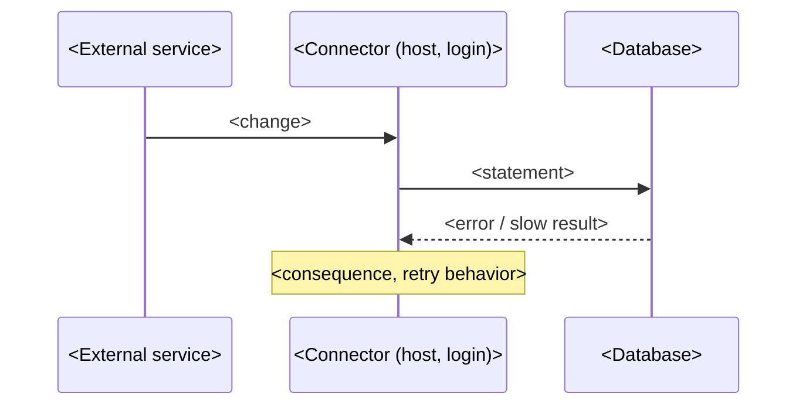

# <Product / component>: <defect in one line>

**For:** <vendor> support (<module>) \
**From:** <company>, DBA team (<date>) \
**Severity requested:** <P2 – data not saved for n records / performance> \
**Environment:** <product version>; SQL Server <version> (<build>), compatibility level <n>, <legacy | default> CE; <database>

## 1. Summary

<3–4 sentences: what fails or costs, since when, how often, what it breaks for the business, and what we need from the vendor.>

## 2. Which component this is, and how we know

| Evidence | Value |
|---|---|
| Login | `<login>` (created <date time>) |
| Host / process | `<host>`, PID <n> (Windows service <name, if confirmed by the user>) |
| Client library | `<client_interface_name>`; Application Name <blank / value> |
| Installed | <settings rows / data loaded on <date>, matching the login's creation> |

## 3. The defect

The statement as SQL Server receives it (from the plan cache / Query Store):

```sql
<exact text with parameter declarations>
```

<Why it fails or is slow, in the vendor's terms: e.g. "COALESCE returns the highest-precedence type of its arguments, so COALESCE(@p bigint, col varchar(12)) is bigint; any existing non-numeric value raises 8114 even when @p is NULL.">



## 4. Evidence: volumes and trend

| Day | Failed | Succeeded | Notes |
|---|---:|---:|---|

## 5. How to reproduce and verify (for your support engineer)

Everything below runs read-only: no procedure is called, no data or table changes, so it is safe on your test system and on a customer's production server. Expect about <15–30> minutes. Full script: `<repro_<object>.sql>` (attached, and in Appendix A).

**Environment that reproduces it** (section 0 of the script prints yours; the settings in bold decide the plan):

| Setting | Ours |
|---|---|
| SQL Server | <version, CU, edition> |
| **Compatibility level / cardinality estimator** | <n> / <legacy | default> |
| **MAXDOP / cost threshold** | <n> / <n> |
| RCSI / Query Store | <on/off> / <state> |
| `<schema>.<object>` | SHA-256 `<0x…first 8…last 8>`, modified <date> (version header "<…>") |
| **Data shape** | `<table>`: <n> rows; <the distribution that matters: e.g. 2.3M rows carry the value 'UNKNOWN'> |

**Steps**

1. Run sections 0–2 and compare with the table above. If compatibility level, CE or the data shape differ, the plan may not go wrong: <how to get a matching row, e.g. "pick the value with the most rows: the commented query in section 2">.
2. Set the parameters in the EDIT ME block to <values / the value from step 1>. Turn on "Discard results after execution" in SSMS, or run with sqlcmd.
3. Run the script. Section 4 prints one row per run. **As shipped you should see** <operator> on `<table>` (NodeId <n>), about <n> logical reads and <n> ms CPU per run; the first run also shows <n> physical reads.
4. Open the actual plan of an "as shipped" run: the <operator> at NodeId <n> reads <n> rows to return <n>; its predicate is `<predicate>` (it can't seek `<index>` because <reason>).
5. Compare with the "with change" runs: <Index Seek on `<index>`>, about <n> logical reads and <n> ms CPU. Section 5 shows the same row count and checksum for both.
6. Optional, to size it across customers: section 7 lists this statement's plans and cost from Query Store in any database.

**Expected results** (ours, from the same script on <date>):

| Run | CPU ms | Elapsed ms | Logical reads | Physical reads | Main waits |
|---|---:|---:|---:|---:|---|
| As shipped, cold | | | | | |
| As shipped, warm | | | | | |
| With the change | | | | | |

**Pass:** as shipped >= <n> logical reads (reproduced) and with the change <= <n>, same rows. Attached: `<object>_as_shipped.sqlplan`, `<object>_with_change.sqlplan`, `repro_output_<company>.txt` (our full output).

## 6. Impact assessment

| Area | Impact |
|---|---|
| Data | <n records never updated; which fields; how stale> |
| Business | <who sees wrong data; compliance / billing / dispatch consequence> |
| Exposure | <n records that would hit the same bug on their next change> |
| Performance | <CPU, log, retries; often negligible: say so> |
| Operations | <noise in error logs, alerts, investigation time> |

## 7. What we have done locally

<Nothing (vendor code / service) | the in-procedure change, exact lines, marked "-- <MARKER>".>

## 8. Suggested fix

- <correct parameter type: varchar(12) to match the column>
- <declare parameter types explicitly in the data layer>
- <set Application Name in the connection string>
- <back off after repeated failures for the same record>
- <replay the failed changes once fixed>

## 9. Questions for the vendor

1. <Is this a known defect / which release fixes it?>
2. <Can you replay the backlog?>
3. <Did the reproduction in section 5 match on your system? If not, which of sections 0–2 differed?>

## Appendix A: reproduction script

```sql
<the filled repro_<object>.sql, as attached>
```

## Appendix B: scripts and raw output

`<repo>\sql\<topic>\` — read-only scripts with result files.

<For an error rather than a slow plan (a failing statement), section 5 is the same idea: the statement and parameter types as SQL Server receives them, one row that makes it fail and one that doesn't, a read-only SELECT that raises the same error without writing, and the count of rows exposed. See `references/repro-kit.md`.>
