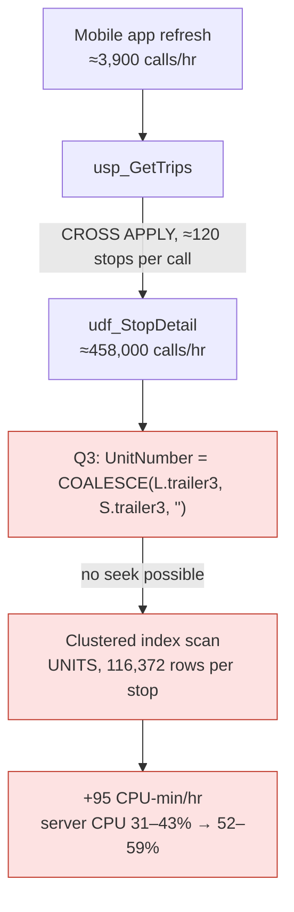
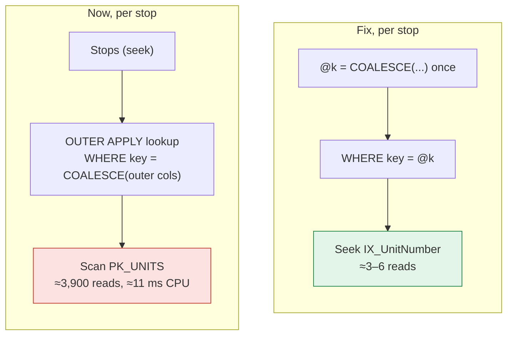
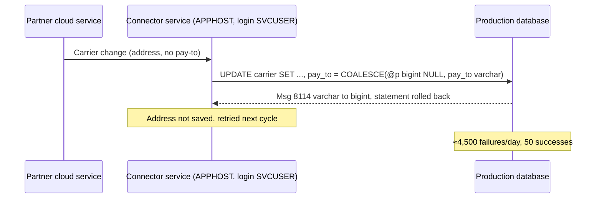
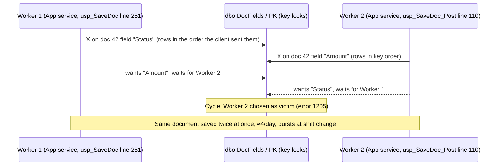

# Diagrams and reports

## Which diagram for what

| Show | Mermaid type | Pattern |
|---|---|---|
| The hot path: caller → procedure → statement → the expensive operator → the cost | `flowchart TB` (LR only for ≤ 5 nodes) | Nodes carry numbers (calls/hr, rows per call, ms); the bad nodes are red (`style x fill:#fde2e2,stroke:#c0392b`) |
| Before vs after plan shape | `flowchart LR` with two `subgraph`s, each `direction TB` | Red for the scan in "now", green (`fill:#e3f4e8,stroke:#1e8449`) for the seek in "fix" |
| An integration's call sequence, including where it fails | `sequenceDiagram` | Participants = external system, connector/service (host, login), database; notes for counts |
| A deadlock cycle | `sequenceDiagram` | Participants = each side (caller, code:line) and the locked table/index; arrows = locks taken, then waits; a note names the victim, the rate and the upstream driver |
| Trend (hourly CPU, today vs week ago) | `xychart-beta` (mermaid ≥ 10.6) or a hand-placed SVG polyline in an HTML report | Label hours on the x-axis; say which line is which in the caption |
| Where the CPU goes, by group | `pie` (sparingly) or a table | Tables are usually clearer |
| Timeline of a regression and fix | `timeline` or a small table | Deploy times, hot-fix time, verification |

A diagram should let the reader point at the box that is the problem. If it doesn't show a mechanism or a number, use a table instead.

### Examples

A deadlock pattern (from sql-deadlock-analysis): one participant per side, named by its caller, then the locks in time order, then the victim. Keep table and index names; they are what the developer needs.

### Mermaid gotchas (mermaid 10.x)

- **Semicolons in `sequenceDiagram` messages and notes end the line.** Use commas.
- Quote every label that contains punctuation: `id["text (with) punctuation"]`. Use ` ` for line breaks.
- `~` pairs render as strikethrough when the markdown is rendered by `marked`; write `≈` for "about".
- Side-by-side subgraphs come out tiny in `flowchart LR`; give each subgraph `direction TB`.
- `#` starts an entity in some labels; write "no." or spell it out.
- `xychart-beta` needs mermaid ≥ 10.6; pin the version you render with.
- A straight chain of more than ~5 nodes in `flowchart LR` is scaled down until it is unreadable; use `flowchart TB` for the hot path.
- Two unlinked subgraphs may be laid out in reverse order or stacked; add an invisible link (`now ~~~ fix`) to put them side by side in order.
- Keep a diagram to ~12 nodes. Split it rather than shrink it.

## Rendering to HTML and PDF (local, no server touched)

1. Copy `core/render/report_shell.html` next to the markdown, set the `<title>`, and paste the markdown between the ``).
2. Print with `core/render/render_pdf.ps1 -Html <file.html> -Pdf <file.pdf>` (headless Edge or Chrome, `--virtual-time-budget` so mermaid finishes).
3. Take one screenshot (`-Screenshot`) and look at it: diagrams rendered (not raw text), nothing overflows, tables fit.

The shell loads `marked@12.0.2` and `mermaid@10.9.1` from jsDelivr, so the machine rendering it needs internet access; the PDF is self-contained.

## Report structures

### Analysis of one problem (`core/templates/docs/analysis_TEMPLATE.md`)
1. Title with object, server role (not hostname if sharing outside), date.
2. Verdict in 3–5 lines: what's wrong, how much it costs, the fix, the saving, status.
3. Scope and method: windows (time zone), sources, read-only statement, script folder.
4. Findings, each: evidence table → root cause sentence → diagram → fix → measured/expected saving.
5. Variants tried and rejected.
6. Ruled out.
7. Next steps with owners. Updates appended as dated sections ("Update 14:35: hot-fix verified").

### Vendor ticket (`core/templates/docs/vendor_ticket_TEMPLATE.md`)
Summary → component identification (how we know) → the defect (statement, types, error) → sequence diagram → evidence (daily counts, start date) → **how to reproduce and verify** (environment table, numbered steps with what they should see, expected-results table, pass criteria, attachments; `references/repro-kit.md`) → impact assessment (data, business, exposure, performance) → what we did locally → suggested fix → asks → appendix A (the reproduction script) → appendix B (scripts, raw output).

### Health / hour-over-hour report
Verdict paragraph → key metrics (week ago / baseline / today / change) → hourly table and chart → integrations table (CPU, reads, execs, timeouts, errors, vs week ago) → resources with verdicts → what was fixed since the comparison day → ranked candidates (today's CPU, fix, owner, status, est. saving/day) → settings to consider → bottom line.

## Style

- Verdict first. Numbers in tables, not prose.
- Every number has a window and a source. Hedge estimates with ≈.
- Name objects in code font. Use the vendor's names for their objects.
- When sharing outside the team, drop internal hostnames and IPs unless the recipient needs them (a vendor ticket usually does need the service host).
